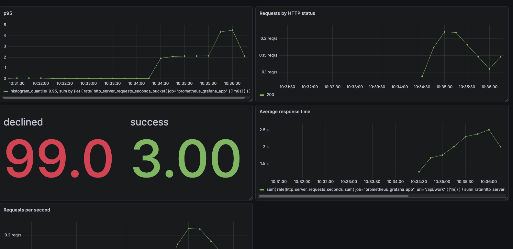

# Prometheus + Grafana
Простое приложение, чтобы вспомнить на практике как работает связка Prometheus + Grafana.
Приложение коннектится с прометеусом, прометеус с графаной. Приложение отдает методы на свой эндпоинт, а прометеус ходит на этот эндпоинт и пулит данные к себе.

В графане построил простейшие дэшборды на основе метрик из прометеуса, подключил алерт для реагирования на множество платежных отказов.


## Запуск

```bash
docker compose up --build -d
```

## Нагрузка

```bash
curl "http://localhost:8080/api/work?delayMs=100&fail=false"
curl "http://localhost:8080/api/work?delayMs=1000&fail=false"
curl -i "http://localhost:8080/api/work?delayMs=500&fail=true"
```

### Эндпоинт для учета бизнес метрики
```bash
curl -X POST "https://localhost:8080/api?decline=true"
```

Метрики приложения находятся по адресу http://localhost:8080/actuator/prometheus.

## Остановка

```bash
docker compose down
```

Чтобы удалить также сохранённые данные Prometheus и Grafana:

```bash
docker compose down --volumes
```
